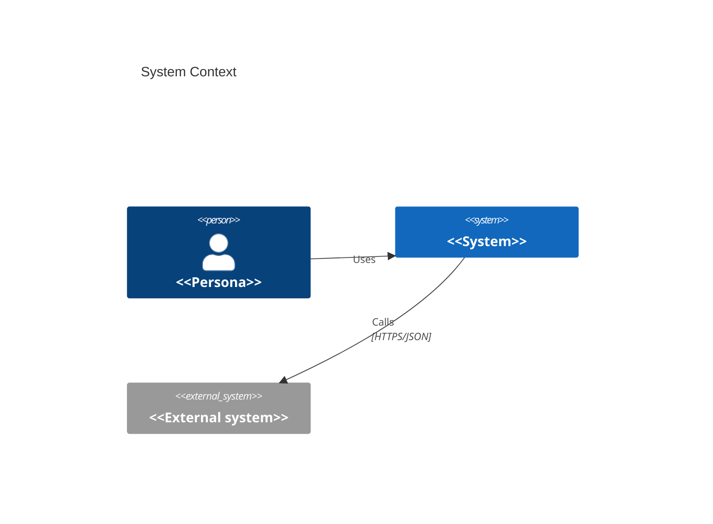

# Solution Architecture — <<System Name>>

| Field | Value |
|-------|-------|
| Version | 0.1 |
| Owner | solution-architect |
| Status | Draft / In Review / Approved (G3) |
| Inputs | PRD v<<x>>, UX spec v<<x>> |

## 1. Architectural Drivers
Key FRs, quantified NFRs, constraints and quality-attribute priorities (ranked).

## 2. System Context (C4 L1)

Trust boundaries: <<list>>

## 3. Containers (C4 L2)
| Container | Responsibility | Technology | Communicates with | Scaling approach | Owner |
|-----------|----------------|------------|-------------------|------------------|-------|

## 4. Components (C4 L3)
<<Per container touched by the first releases.>>

## 5. Data Architecture
- Logical model (entities, relationships, key attributes) — Mermaid ER diagram
- Data classification & ownership
- Retention, archival, deletion (privacy)
- Migration approach

## 6. Interfaces & Integration
| API / Event | Method & path / topic | Request | Response | Errors | AuthZ | Idempotent | Versioning |
|-------------|----------------------|---------|----------|--------|-------|------------|-----------|
Error model, pagination, rate limits, contract-testing approach.

## 7. NFR Tactics
| NFR ID | Target | Tactic(s) | Component(s) | Verification method |
|--------|--------|-----------|--------------|---------------------|

## 8. Security Architecture
AuthN/AuthZ model · secrets management · encryption in transit/at rest · input validation ·
audit logging · supply chain. **Threat model (STRIDE) per trust boundary:**
| Boundary | Threat | Category | Mitigation |
|----------|--------|----------|------------|

## 9. Operational Architecture
Environments · CI/CD stages · IaC · observability (logs, metrics, traces, SLOs, alerts) ·
backup/restore · DR (RPO/RTO) · feature flags · release & rollback strategy.

## 10. Source Tree & Conventions
```
<<directory layout with one-line purpose per folder>>
```
Layering rules · module boundaries · naming conventions.

## 11. Technology Stack
| Layer | Choice | Version | Rationale | Licence | ADR |
|-------|--------|---------|-----------|---------|-----|

## 12. Coverage Matrix
| Requirement (FR/NFR) | Component(s) | Notes |
|----------------------|--------------|-------|

## 13. Architecture Decisions
| ADR | Title | Status |
|-----|-------|--------|

## 14. Technical Risks & Debt
| Risk / debt | Impact | Mitigation | Addressed by (epic/story) |
|-------------|--------|------------|---------------------------|

## 15. Open Questions
