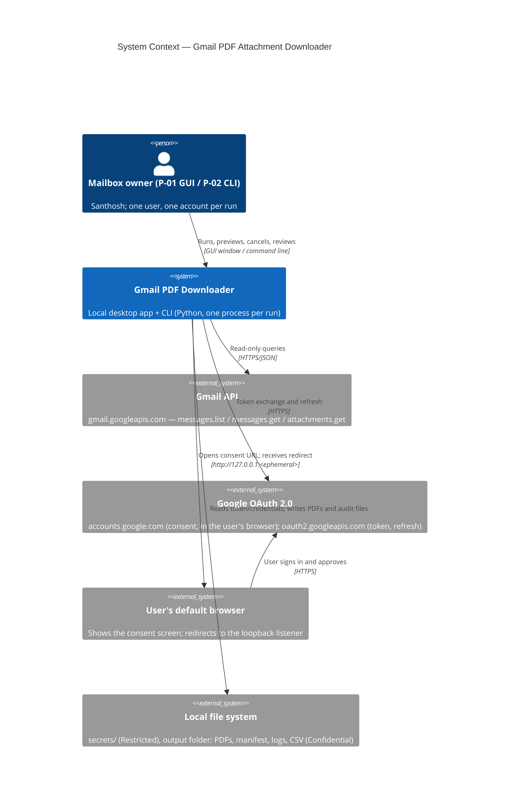
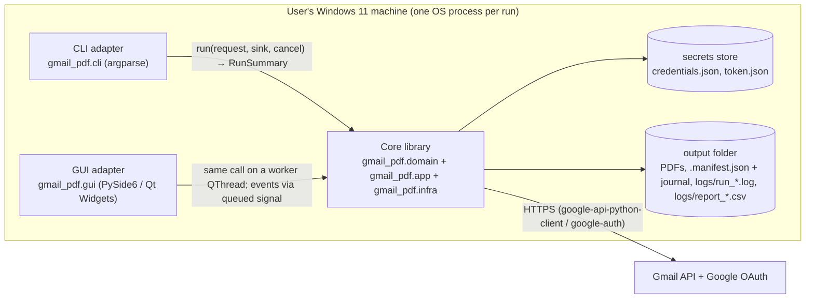
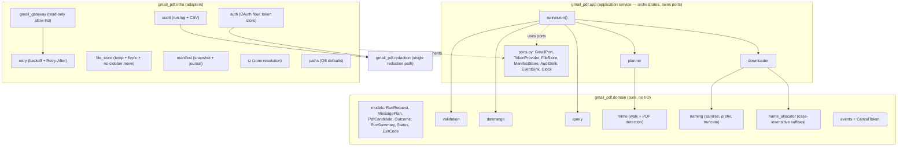
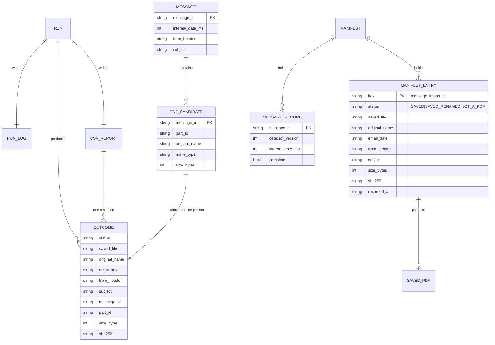

# Solution Architecture — Gmail PDF Attachment Downloader

| Field | Value |
|-------|-------|
| Version | 0.2 |
| Owner | solution-architect |
| Date | 2026-10-29 |
| Status | In Review (G3 condition C10 closed; G4 entry). C9 outcome: ux-spec v0.3 (4f1536f) accepts UX-I-01..06 and defines R-COUNT, adopted here (§17.4) |
| Inputs | **PRD v0.4** (commit 5dc3289; PD-17..PD-20; current; v0.3 f1ba385 was the version reviewed at G3), release-plan v0.2, requirements-catalog v0.2+, RD (Oct 28, 2026), decisions D-01..D-34 (D-29: shadcn/ui not used), delivery-lead decisions of 2026-10-29 (PGD-1 comment 10108), RISK-001..019, coding-standards and DoD as amended (commits e71302b, 834f7d2, 481a46f), **UX spec v0.3** (commit 4f1536f; current; C9 outcome and R-COUNT; v0.2 d200c27 was the version reviewed at G3) + wireframes (reconciled in §17), G3 record (gate-log, conditions C9–C11) |
| Jira | [PGD-1](https://sankumar76.atlassian.net/browse/PGD-1) |
| Companions | [ADR index](#13-architecture-decisions) · [test-strategy.md](test-strategy.md) |

**ID conventions.** `AQ-` = architecture open question; `AA-` = architecture assumption; `AR-` = architecture risk (proposed to master for the register); `S-` = spike. FR/NFR IDs are PRD v0.4 IDs (FR-001..066, NFR-001..025; the same ID set as v0.3). The change log is in §18.

---

## 1. Architectural Drivers

### 1.1 Quality-attribute priorities (ranked)
1. **Security and privacy** — one OAuth scope, zero mailbox writes, zero secret leakage on every surface (FR-001..005, NFR-011..016; RISK-005, RISK-009).
2. **Correctness and data safety** — complete retrieval in the inclusive range, deterministic names, never overwrite, idempotent re-runs, interrupt safety (FR-008..031, NFR-007, NFR-008; RISK-007, RISK-008).
3. **Auditability** — every eligible run reconciles (GOAL-10, FR-039..043, NFR-005).
4. **GUI/CLI parity on one core** — D-01, FR-064, GOAL-07.
5. **Usability and design consistency** — CLAUDE.md §9, FR-047..060 (RISK-001, RISK-012).
6. **Performance** — NFR-001..004, 009, 010 (PA-01 proposals; RISK-011).
7. **Maintainability** — small dependency set (NFR-023), strict typing and coverage (NFR-022).

### 1.2 Constraints
CONSTRAINT-01..10 (catalogue): `gmail.readonly` only; Python 3.10–3.12; Google libraries only unless an ADR justifies another; **no database**; GUI + CLI on one core; CLAUDE.md §9; local processing; 25 MB attachments; pytest/ruff/mypy-strict, package `gmail_pdf`; secret files never read during development (SEC-08). D-04: no `config.yaml`/`.env` settings file (CFG-11 Won't). **Target OS confirmed: Windows 11** (Q-02, delivery lead 2026-10-29); macOS/Linux stay best effort (NFR-020). **Schedule:** as soon as possible, no fixed date (Q-01); R1 (core + CLI) ships first and does not depend on the GUI framework spike (ADR-001, C11).

### 1.3 Simplicity statement
The product is **one Python package** run as a local process. There is no server, no database, no message broker and no background service. Each additional moving part below is justified where it appears: the GUI toolkit (ADR-001), time-zone data (ADR-002), a manifest journal instead of a single JSON rewrite (ADR-004).

---

## 2. System Context (C4 L1)



**Trust boundaries**

| ID | Boundary | Crossing data |
|----|----------|---------------|
| TB-1 | Internet: app ↔ Google APIs (Gmail, OAuth) | Bearer tokens, refresh token, client secret (outbound); email metadata and attachment bytes (inbound, **untrusted**) |
| TB-2 | Loopback OAuth redirect: browser ↔ app listener on `127.0.0.1:<ephemeral port>` | Authorisation code (one-time) |
| TB-3 | Local file system: app ↔ `secrets/` and the output folder | Restricted (credentials, token) and Confidential (PDFs, log, CSV, manifest) data at rest |
| TB-4 | Untrusted content → app logic: file names, headers (`From`, `Subject`), MIME structure, bytes | Path traversal, CSV/log/rich-text injection, malformed MIME |
| TB-5 | Supply chain: PyPI packages → app | Third-party code (ADR-002) |
| TB-6 | User → app inputs (CLI args, GUI fields) | Dates, time zone, query text, paths |

---

## 3. Containers (C4 L2)

A "container" here is a separately runnable unit or a separately owned store. All run on the user's machine.



| Container | Responsibility | Technology | Communicates with | Scaling approach | Owner |
|-----------|----------------|------------|-------------------|------------------|-------|
| Core library (`gmail_pdf.domain`, `.app`, `.infra`, `.redaction`) | All behaviour: validation, auth, search, MIME walk, naming, saving, manifest, audit, retry, redaction, progress events, cancellation | Python 3.10–3.12, google-api-python-client, google-auth(-oauthlib, -httplib2), zoneinfo + tzdata, tzlocal | Google APIs over HTTPS; local FS | Vertical only. Sequential fetch (one message, one attachment in memory at a time). Seam for ≤ 4 fetch workers (FR-038) without changing naming | developer (implements), solution-architect (design authority) |
| CLI adapter (`gmail_pdf.cli`) | Parse RD §3 flags, map to `RunRequest`, render events to console, Ctrl+C → cancel, map `RunSummary` to exit code | Python stdlib `argparse`, `signal` | Core (in-process call) | n/a (one run per process) | developer |
| GUI adapter (`gmail_pdf.gui`) | One window: form, sign-in, dry run, run, cancel, live counts, summary, open folder/log/CSV; design tokens, one button component | PySide6 (Qt 6 Widgets) — ADR-001 | Core (in-process, worker thread) | n/a (single window; event throttling for NFR-004) | developer, ux-expert (spec) |
| Secrets store | `credentials.json` (user-supplied), `token.json` (app-written) | JSON files, OS permissions (ADR-003) | Core `infra.auth` only | n/a | Mailbox owner (data); core (access) |
| Output folder | Saved PDFs, manifest snapshot + journal, run logs, CSV reports | Files; no database (CONSTRAINT-04) | Core `infra.store`, `infra.manifest`, `infra.audit` | Tested to 50,000 manifest entries and 10,000 messages per range (NFR-010) | Mailbox owner (data); core (format) |

---

## 4. Components (C4 L3)

### 4.1 Core library



| Component | Module | Responsibility | Key FRs |
|-----------|--------|----------------|---------|
| Models | `domain/models.py` | Frozen dataclasses and enums: `RunRequest`, `MessageRef`, `MessagePlan`, `PdfCandidate`, `Outcome` (one CSV row), `RunSummary`, `Status` (LOG-03 values only), `RunResult`, `ExitCode` | FR-041, 042, 043 |
| Validation | `domain/validation.py` | One set of rules and messages for CLI and GUI: date format, start ≤ end, future-end warning, IANA zone, output path not a file, query length | FR-015, 048 |
| Date range | `domain/daterange.py` | Local start 00:00 and next calendar day 00:00 in the zone → epoch seconds; `contains(internal_date_ms)` | FR-008, 012 |
| Query builder | `domain/query.py` | Builds the baseline and recall-sweep queries (§6.2) plus the user `--query` text | FR-009, 010, 017 |
| MIME walker | `domain/mime.py` | Recursive walk of the `messages.get(format=full)` payload incl. `multipart/*` and `message/rfc822`; PDF rule (FR-019); part order = document order; RFC 2047/2231 decoding of names | FR-018, 019, 025 |
| Naming | `domain/naming.py` | Sanitise (§6.6), date prefix, 200-char limit on the stem only | FR-022..025, 027 |
| Name allocator | `domain/name_allocator.py` | Case-insensitive (NFC + `casefold`) set of names on disk + assigned this run; `_1`, `_2` … ; single-threaded by construction | FR-026, 038 |
| User texts | `domain/messages.py` | One table of every user-facing sentence (errors, warnings, first lines, setup steps) shared by CLI, GUI and README excerpts, so wording is identical (FR-064, ux-spec §6.B) | FR-006, 033, 037, 043 |
| Events / cancel | `domain/events.py` | Event dataclasses (§6.8), `EventSink` protocol, `CancelToken` (wraps `threading.Event`) | FR-037, 050, 051 |
| Runner | `app/runner.py` | The single entry point `run(request, deps, sink, cancel) -> RunSummary`: phases, failure isolation, summary, exit code | FR-016, 036, 037, 042, 043 |
| Planner | `app/planner.py` | Phase 2: fetch metadata for each unprocessed candidate, re-check range, extract `PdfCandidate`s, sort (FR-014) | FR-012, 014, 017, 044 |
| Downloader | `app/downloader.py` | Phase 3: per candidate: manifest check, fetch bytes, `%PDF-` check, allocate name, save, journal, CSV row | FR-020, 021, 026, 028..031 |
| Auth | `infra/auth.py` | Credentials/token path resolution, loopback consent, silent refresh, `invalid_grant` handling, token file write with permissions | FR-001..004, 006 |
| Gmail gateway | `infra/gmail_gateway.py` | The only module importing `googleapiclient`. Exposes exactly `list_message_ids`, `get_message`, `get_attachment`; no other method exists | FR-009, 011, 020; NFR-011 |
| Retry | `infra/retry.py` | Backoff with jitter, `Retry-After`, cancel-aware sleeps (§6.4) | NFR-006 |
| File store | `infra/file_store.py` | Output-folder resolution, containment check, temp file + `fsync` + no-clobber atomic move, directory listing for the allocator | FR-027, 028, 031 |
| Manifest | `infra/manifest.py` | Load/validate snapshot + journal, append records, compact, last-good backup (ADR-004) | FR-029, 030, 032, 033, 034 |
| Audit | `infra/audit.py` | Run log (`logging.FileHandler` + redaction filter) and CSV writer (row flushed per outcome, formula-injection neutralised) | FR-039, 040, 041, 046 |
| Time zone | `infra/tz.py` | System IANA zone via `tzlocal`, `ZoneInfo` with `tzdata` fallback (ADR-002) | FR-008 |
| Paths | `infra/paths.py` | OS-specific defaults for secrets and output (ADR-003, §8.2) | FR-002, 004 |
| Redaction | `redaction.py` | The one redaction path: secret registry + patterns, `logging.Filter`, `safe_message(exc)`, `sys.excepthook`/`threading.excepthook` installers | FR-005; NFR-012 |
| Composition root | `bootstrap.py` | Wires infra adapters into `Deps` for the CLI and the GUI (one place, so parity holds) | FR-064 |

### 4.2 CLI adapter (`gmail_pdf/cli/`)
| Component | Responsibility |
|-----------|----------------|
| `args.py` | RD §3 flags exactly (FR-045) plus argparse's standard `-h/--help` (PD-16: prints the flag table with defaults, exits 0, parsed before any path resolution, credential read, logging setup or network call); unknown flag → exit 2; env-var precedence for paths (FR-002) |
| `console.py` | `EventSink` that prints progress lines (stderr) and the final summary (stdout), dry-run plan table |
| `main.py` | `main(argv) -> int`: install redaction hooks, build `RunRequest`, call `runner.run`, SIGINT → `cancel.set()` (a second Ctrl+C prints `Already stopping, please wait.` once and is otherwise ignored; closing the terminal is the safe hard kill — UX-I-05, §6.9), return `ExitCode` |
| `gmail_pdf/__main__.py`, repo-root `gmail_pdf_downloader.py` | Thin shims calling `cli.main.main` (RD invocation `python gmail_pdf_downloader.py --start …` keeps working) |

### 4.3 GUI adapter (`gmail_pdf/gui/`) — R2
| Component | Responsibility |
|-----------|----------------|
| `theme/tokens.py` | **Single source of truth** (FR-054..057): 4 typography roles, spacing scale, palette, radii, focus ring, min window size, `layout.stat.min` (minimum count-tile width, so counts never jump; ux-spec v0.3 §7.2, UX-I-06) and `motion.fast` = **0** in R2 (no transitions; token kept for a later build, UX-I-01). Pure Python constants, no Qt import |
| `theme/stylesheet.py` | Generates the application QSS and `QFont`s from tokens; nothing else contains a colour, size or spacing literal |
| `widgets/button.py` | `AppButton(QPushButton)` with `Variant` = PRIMARY / SECONDARY / DESTRUCTIVE (FR-056); the only button class used |
| `widgets/*` | Field row with inline error label, date edit, zone combo (IANA list), folder picker, count tiles, results table (plain-text model) |
| `view_model.py` | Qt-free presenter: holds form state, calls `domain.validation`, maps events to display state, decides enabled/disabled controls. Unit-testable without Qt |
| `worker.py` | `RunWorker(QObject)` on a `QThread`; runs `runner.run`; forwards events through a queued `Signal(object)`; implements ux-spec **R-COUNT** in two stages: (1) the worker's sink forwards `Progress` at most every 100 ms (**≤ 10 Hz**, latest value wins, checked with `time.monotonic()` inside the sink because the worker thread is busy in `run()`), which protects the UI thread's input queue (NFR-004 stall ≤ 200 ms); (2) the view redraws counts, bar, elapsed time and current-item line **at most 4 times a second** (UI-thread `QTimer`, 250 ms, latest value wins, no queue). Every other event (`PhaseChanged`, `CancelRequested`, `OutcomeRecorded`, `RunFinished`, …) is forwarded and drawn at once, in order, so the final screen equals the summary and the CSV |
| `main_window.py`, `dialogs/setup_help.py`, `dialogs/summary.py` | Screens per the UX spec; setup help shows RD §2.1 steps when `credentials.json` is missing (FR-006) |
| `app.py` | `main()`: rounding policy, install redaction hooks + Qt message handler, apply stylesheet, show window (lazy-import Google libraries after first paint for NFR-004 launch time) |

**Layering rules (enforced by an import-boundary test, §10.2).** `domain` imports nothing from the package except `domain`. `app` imports `domain` only (ports are protocols). `infra` imports `domain`, `app.ports`, `redaction`. `cli` and `gui` import `app`, `domain`, `bootstrap`, `redaction` — never `googleapiclient`, `google.*`, `infra.gmail_gateway` directly. Only `infra/gmail_gateway.py` and `infra/auth.py` import Google libraries. Only `gui/**` imports `PySide6`.

---

## 5. Data Architecture

No database (CONSTRAINT-04). All persistent data are files owned by the mailbox owner.

### 5.1 Logical model



### 5.2 File formats

| Artefact | Path | Format | Written |
|----------|------|--------|---------|
| Saved PDF | `<out>/YYYYMMDD_<name>[_n].pdf` | Raw bytes, unchanged | Temp `<out>/.gmail_pdf-<uuid4>.part` → `fsync` → no-clobber move (ADR-004) |
| Manifest snapshot | `<out>/.manifest.json` (RD FR-17 name kept) | JSON: `{"schema_version":1,"app_version":…,"entries":{key:{…}},"messages":{id:{…}}}` | Compaction at run end/cancel: temp + `os.replace` (overwrite intended); previous snapshot kept as `.manifest.json.bak` (last good) |
| Manifest journal | `<out>/.manifest.journal` | JSON Lines, one record per event: `{"op":"pending"|"commit"|"message_done", …}` | Append + flush + `fsync` per record; truncated after successful compaction |
| Run log | `<out>/logs/run_<YYYYMMDD_HHMMSS>[_n].log` | UTF-8 text, `%(asctime)s %(levelname)s %(message)s`, control characters escaped | Opened with **exclusive create** (`logging.FileHandler(path, mode="x", encoding="utf-8")`); never appended to or replaced; line-buffered; redaction filter on the handler (coding-standards §10; D-32) |
| CSV report | `<out>/logs/report_<YYYYMMDD_HHMMSS>[_n].csv` | UTF-8 with BOM (Excel opens Unicode correctly — AA-07), header = LOG-02 order exactly, RFC 4180 quoting | Opened with **exclusive create** (`open(path, "x", newline="", encoding="utf-8-sig")`); never appended to or replaced. One row per outcome, `flush()` after each row (GOAL-10 ≤ 1 row lost on hard kill) (coding-standards §10; D-32) |
| Token | `token.json` (path per FR-002) | `google.oauth2.credentials.Credentials.to_json()` | Temp + `os.replace`; POSIX `0600`; ADR-003 |

Timestamps in file names use the **run's chosen zone** at run start (AA-08). If the log or CSV name already exists (two runs started in the same second, or a user file with that name), exclusive create raises `FileExistsError` and the next free `_1`, `_2`, … name is used (coding-standards §10; never overwrite).

### 5.3 Classification, ownership, retention

| Data | Classification | Owner | Retention / deletion |
|------|----------------|-------|----------------------|
| `credentials.json` (DR-003) | Restricted | Mailbox owner | User-managed; never read by developers (SEC-08) |
| `token.json` (DR-004) | Restricted | Mailbox owner | Deleted by the app on `invalid_grant` (FR-003) and on sign-out (FR-007, R3) |
| Saved PDFs (DR-002) | Confidential (may be Restricted) | Mailbox owner | User-managed (PA-08) |
| Manifest (DR-005) | **Confidential** (it now holds `from`/`subject` so skipped rows can be reported without re-fetching; same fields as the CSV, NFR-016 holds). BA to update DR-005 classification (Issues for other roles) | Mailbox owner | Lifetime of the output folder |
| Run log, CSV (DR-006/007) | Confidential | Mailbox owner | User-managed; README guidance (FR-066) |
| Email metadata in memory (DR-001) | Confidential | Mailbox owner | Process lifetime only; message bodies are never stored or logged (NFR-016) |

### 5.4 Migration / schema evolution
`schema_version` in the snapshot and `detector_version` per message record. A newer app reading an older schema migrates in memory and writes the new version at compaction (the old file stays as `.bak`). An older app reading a newer schema stops with the FR-032 message (never overwrites). `detector_version` increments when PDF-detection rules change, so earlier "complete, 0 PDFs" messages are re-examined; already-saved keys are still skipped.

---

## 6. Interfaces & Integration

### 6.1 Core API (the contract both front ends use)

```python
def validate(form: RawInputs, today: date) -> ValidationResult: ...   # errors + warnings, same text in CLI and GUI
def resolve_paths(inputs: PathInputs, env: Mapping[str, str], front_end: FrontEnd) -> ResolvedPaths: ...
def check_client_file(paths: ResolvedPaths) -> ClientFileStatus: ...  # local only, no flow, no network: MISSING | BAD_CLIENT_FILE | OK (UA-12)
def auth_status(paths: ResolvedPaths) -> AuthStatus: ...               # local only, no network: NO_CREDENTIALS | BAD_CLIENT_FILE | NOT_SIGNED_IN | SIGNED_IN
def sign_in(paths: ResolvedPaths, sink: EventSink, cancel: CancelToken) -> AuthStatus: ...  # loopback consent (DLG-01)
def preflight(request: RunRequest, deps: Deps) -> PreflightReport: ... # read-only: manifest state (OK | MISSING_WITH_PDFS | UNREADABLE), missing-file count
def run(request: RunRequest, deps: Deps, sink: EventSink, cancel: CancelToken) -> RunSummary: ...
```

- `run` is **synchronous and thread-agnostic**: the CLI calls it on the main thread; the GUI calls it on a worker `QThread`. It never touches UI objects.
- `preflight` lets the GUI show DLG-03 (history unreadable) and DLG-04 (PDFs but no history, confirm) **before** starting; `run` re-checks the same conditions itself, so the CLI (which warns and continues, FR-033) and the GUI cannot diverge in behaviour (FR-064).
- **Client-file check (UA-12, ux-spec v0.3).** `check_client_file` parses `credentials.json` structurally (JSON object with an `installed` key; ADR-003 §4) **without starting the OAuth flow** and without network. The GUI calls it at launch and on `Check again`, so the wrong-file Notice appears before any sign-in. `auth_status` calls it first, and `sign_in`/`run` call it again before `InstalledAppFlow` is created. In the CLI a wrong file stops the run before any flow with the fixed `BAD_CLIENT_FILE` message and **exit 3** (§6.5). File contents are never logged or shown.
- `auth_status` reads only the local credentials and token files (no API call). The account e-mail address is **never** fetched: `users.getProfile` is outside the NFR-011 allow-list, and adding `openid email` scopes would break FR-001.
- `RunSummary` holds the seven FR-042 fields, `result: RunResult` (`COMPLETED`, `COMPLETED_WITH_ERRORS`, `CANCELLED`, `FAILED`, `AUTH_FAILED`), warnings, paths of the log and CSV (or `None` for dry runs), and `exit_code`.
- `Deps` (built by `bootstrap.build_deps`) holds the port implementations; tests substitute fakes.

### 6.2 Gmail API usage (read-only allow-list — NFR-011)

| Purpose | Method | Parameters | Response used |
|---------|--------|------------|---------------|
| Candidate search (baseline, RD FR-02) | `users.messages.list` | `userId="me"`, `q="has:attachment filename:pdf after:<S-1> before:<E+1> <user query>"`, `maxResults=500`, `includeSpamTrash`, `pageToken`, `fields="messages/id,nextPageToken"` | ids |
| Recall sweep (FR-017, ADR-007) | `users.messages.list` | same, `q="has:attachment -filename:pdf after:… before:… <user query>"` | ids not in the baseline set |
| Metadata + structure | `users.messages.get` | `format="full"` | `internalDate`, `payload` part tree (`partId`, `mimeType`, `filename`, `headers`, `body.attachmentId`, `body.size`, inline `body.data` for small parts) |
| Bytes | `users.messages.attachments.get` | `messageId`, `id=<attachmentId>` | `data` (base64url), `size` |

- **Epoch bounds.** `S` = local start 00:00:00 → epoch s; `E` = next calendar day 00:00:00 → epoch s (FR-008). The query is widened by one second on each side (`after:S-1`, `before:E+1`) because Gmail's inclusive/exclusive handling of epoch bounds is not documented (AA-01); the exact range is then enforced locally with `internalDate` (FR-012: `S*1000 ≤ internalDate < E*1000`).
- **Pagination.** Follow `nextPageToken` until absent (FR-011). Ids are de-duplicated across pages and across the two queries.
- **Inline vs attachment bytes (FR-020).** If `body.attachmentId` exists → `attachments.get`; else decode `body.data`. Decoding is `base64.urlsafe_b64decode` with padding restored.
- **Stale `attachmentId` (AA-02).** The RD notes `attachmentId` is not stable across requests. If `attachments.get` returns 400/404 for an id obtained in phase 2, the downloader re-fetches the message once (`format=full`), re-locates the part by `partId`, and retries; a second failure yields an `ERROR` row.
- **Partial responses.** `fields` is used on `list` only (small, low risk). `messages.get` returns the full structure because nested-part `fields` masks are brittle; the planner keeps only a compact `MessagePlan` and drops the payload immediately (NFR-009).
- **Client construction.** `googleapiclient.discovery.build("gmail", "v1", credentials=…, cache_discovery=False)` once per run, reused (coding-standards §10). Static discovery documents shipped with the library are used, so no discovery-document fetch is needed (AA-03, verify in W1). `HttpRequest.execute(num_retries=0)`: the library's own retry (randomised `2^n` backoff on 5xx/429/403-rate-limit, **no `Retry-After`**, verified in the library source via context7) is disabled so NFR-006 is implemented once, in `infra/retry.py`.
- **Quota (AA-04).** Sequential operation at ≈ 300 ms per call is ≈ 200 calls/min. Gmail per-user quota limits (as understood: 5 units per `list`/`get`/`attachments.get`; per-user limit in the order of 15,000 units/min) are far above this. To verify against current Google documentation in W1; NFR-006 handles throttling either way.

### 6.3 Run phases (sequence)

```mermaid
sequenceDiagram
  participant FE as CLI / GUI
  participant R as runner
  participant M as manifest
  participant A as auth
  participant G as gmail_gateway
  participant S as file_store / audit
  FE->>R: run(request, sink, cancel)
  R->>R: validate (exit 2 on error, nothing created)
  alt not dry run
    R->>S: create out dir, open run log + CSV (header)
  end
  R->>M: load snapshot + journal (read-only in dry run)
  Note over R,M: unreadable → stop, exit 1, manifest untouched (FR-032)
  R->>A: credentials (refresh silently / consent / exit 3)
  R->>G: Phase 1 list baseline + sweep (all pages)
  R->>G: Phase 2 messages.get for ids not "complete" in manifest
  R->>R: range re-check, MIME walk, sort (internalDate, len(id), id, part order)
  alt dry run
    R-->>FE: planned names (status PLANNED, unverified), summary; nothing written
  else real run
    loop each candidate in order (cancel checked before every call)
      R->>M: key in manifest? → SKIPPED_ALREADY_DOWNLOADED row
      R->>G: attachments.get (or inline data)
      R->>R: %PDF- check → NOT_A_PDF row
      R->>S: allocate name, temp write + fsync
      R->>M: journal "pending" (fsync)
      R->>S: no-clobber move → final name
      R->>M: journal "commit" (fsync)
      R->>S: CSV row (flush), log line, event
    end
    R->>M: compact snapshot (+ .bak), truncate journal
  end
  R-->>FE: RunSummary (exit code)
```

### 6.4 Retry and backoff (NFR-006)
- Retryable: HTTP 429, 500, 502, 503, 504; 403 with reason `rateLimitExceeded` or `userRateLimitExceeded`; transport errors (`TimeoutError`, `ConnectionError`, `ssl.SSLError`, `httplib2.ServerNotFoundError`).
- Not retryable: other 4xx (400, 401 after refresh, 403 other, 404) → the message/attachment gets an `ERROR` row (FR-036); `RefreshError` → `AUTH_FAILED`, exit 3.
- Schedule: **6 attempts in total**. Delay before attempt *n* (n ≥ 2) = `Retry-After` (seconds or HTTP-date) if present, else full jitter `uniform(0, min(64, 1 × 2^(n-2)))`, always clamped to [0, 64] s. Sleeps use `cancel.wait(delay)` so Cancel interrupts a backoff immediately (NFR-004).
- HTTP timeout: 60 s per request (library default, AA-05). Cancel cannot interrupt an in-flight request; worst case = one request duration.
- Every retry is logged at `WARNING` with method name, attempt and delay — never the URL query string or headers.

### 6.5 Error model and exit codes (answers **PQ-02**)
| Situation | Run result | CLI exit | Log + CSV written? |
|-----------|-----------|----------|--------------------|
| Success, no errors (including 0 PDFs found, FR-016) | `COMPLETED` | 0 | Yes (non-dry run) |
| ≥ 1 `ERROR` row (FR-036) | `COMPLETED_WITH_ERRORS` | 1 | Yes |
| Bad arguments / validation (FR-015, 045) | — | 2 | No (input validation not passed, GOAL-10 scope) |
| `credentials.json` missing or **not a Desktop app OAuth client** (UA-12, checked before any flow), consent failed, `RefreshError` mid-run (FR-003, 006) | `AUTH_FAILED` | 3 | Yes (log + header-only or partial CSV) |
| **Manifest unreadable or newer schema (FR-032, PD-18)** | `FAILED` | **1** | Log + header-only CSV; **no PDF written, manifest untouched** |
| **Unexpected internal exception** | `FAILED` | **1** | Yes; redacted one-line message on console/GUI; redacted traceback in the log at `DEBUG` only |
| User cancel (Ctrl+C, Cancel) (FR-037) | `CANCELLED` | **1** | Yes |

**Distinct first lines (PD-13, PRD v0.3):** cancel → `Run cancelled` (plus "saved files are kept; run the same range again to continue"); unreadable manifest → `error: <path to .manifest.json> cannot be read …` with restore/move-aside steps and the new-folder route (PD-11); internal failure → `error: unexpected failure, see the run log: <path>`. None prints a stack trace or secret. The GUI banner uses the same wording (single text table in `domain/messages.py`).

**Decision (PQ-02, numeric mapping owned by SA under PD-13):** the exit-code set stays **closed at 0–3** (the LOG-05 contract scripts depend on). Exit 1 means "the run did not complete cleanly; read the summary". The `result` field and the summary's first line disambiguate. Rationale: adding codes 4/130 widens a sponsor contract with no requirement asking for it. qa-engineer to confirm (PRD PQ-02 co-owner; cancel = exit 1 confirmed by PD-19). **FR-032 (PD-18, PRD v0.4):** an unreadable manifest writes no PDF and leaves the manifest untouched, but the run log and a header-only CSV are written, so GOAL-10 covers this outcome (AQ-03 closed).

User-facing error text comes only from `redaction.safe_message(exc)` (§8.4): one line, no traceback, no secret, an action hint where known.

### 6.6 Naming algorithm (FR-022..027, BR-001/003/009/010/011, PD-03)
1. **Date** = `internalDate` (ms, UTC) → `ZoneInfo(tz)` → `YYYYMMDD`. Fallback: `Date` header via `email.utils.parsedate_to_datetime` (naive → treated as UTC). Neither available → `ERROR` row.
2. **Original name** = part `filename`, else `Content-Type; name=` / `Content-Disposition; filename*=` (RFC 2231) via `email` stdlib decoding; RFC 2047 encoded-words decoded with `email.header.decode_header`. Empty → `attachment.pdf` (FR-025).
3. **Sanitise:** take the last path segment after `/` and `\`; NFC-normalise; replace `<>:"/\|?*`, Unicode `Cc` and `Cf` (incl. bidi overrides such as U+202E) with `_`; collapse runs of whitespace to one space; strip leading/trailing dots and spaces; strip any trailing `.pdf` (any case) and re-append `.pdf`; empty stem → `attachment`.
4. **Length:** `YYYYMMDD_` + stem + suffix + `.pdf` ≤ 200 characters; only the stem is cut, at a code-point boundary, re-stripping trailing dots/spaces (FR-024).
5. **Suffix (FR-026):** key = `NFC(name).casefold()`. Occupied = names in the output folder at run start (one `os.scandir`) ∪ names assigned this run. First free of `stem.pdf`, `stem_1.pdf`, `stem_2.pdf` … The suffix budget is reserved before truncation so suffixed names also stay ≤ 200.
6. **Containment (FR-027):** `final = (out_dir / name).resolve()`; must satisfy `final.parent == out_dir.resolve()`; otherwise `ERROR`, nothing written.
7. **Race safety:** the move refuses to overwrite (ADR-004). On `FileExistsError` the allocator marks the name occupied and takes the next suffix.
8. **Windows long paths:** file operations on Windows use the `\\?\` extended-length prefix internally so `<out>` + 200-char names work without the `LongPathsEnabled` policy (AA-06; verify in W1). The visible name does not change.
- `casefold` is stricter than NTFS's case rules (e.g. `ß`/`ss`), so it can add a suffix that NTFS would not need, never the reverse. That is the safe direction (no overwrite).
- Order (FR-014, PD-03): `(internalDate, len(messageId), messageId, part document order)`.

### 6.7 Manifest and de-duplication
See ADR-004. Key = `messageId:partId` (never `attachmentId`). Message-level `complete` records let re-runs skip `messages.get` for fully processed messages, which is the main NFR-002 tactic. FR-033 warnings: (a) no manifest but `YYYYMMDD_*.pdf` files exist in the folder; (b) manifest entries whose `saved_file` is missing (counted with one `os.scandir`, not per-file `stat`). FR-034 (R3): rebuild from `logs/report_*.csv` rows with status SAVED/SAVED_RENAMED whose `saved_file` exists and whose `sha256` matches, each file claimed at most once.

### 6.8 Progress events (for FR-050..053, R2)
All events are frozen dataclasses in `domain/events.py`; every string is already redacted and plain text. Ordering is guaranteed (single producer). Sinks must not block; the GUI sink only enqueues.

| Event | Fields | Consumer (UX) |
|-------|--------|---------------|
| `RunStarted` | request echo (no secrets), `started_at` | SCR-05 header |
| `SignInWaiting` / `SignInFinished` | `timeout_s` / `result` (`OK`, `DENIED`, `TIMED_OUT`, `CANCELLED`, `BAD_CLIENT_FILE`) | DLG-01, DLG-02 |
| `PhaseChanged` | `phase` = `SIGNING_IN`, `LISTING`, `PLANNING`, `DOWNLOADING`, `FINALISING` | Phase line; indeterminate bar while `LISTING` |
| `TotalKnown` | `messages_total` (after listing, de-duplicated across both queries), `baseline`, `sweep_extra` | **UQ-02**: `Message N of TOTAL` |
| `Progress` | `messages_done`, `messages_total`, counts `saved/renamed/skipped/not_pdf/errors`, `bytes_saved`, `elapsed_s` | Counts, bar (GUI: R-COUNT, ≤ 10 Hz to the UI thread, redrawn ≤ 4 times a second, §4.3; CLI progress line ≤ 1 per second) |
| `ItemStarted` | `message_id`, `part_id`, `planned_name` (or original name before allocation) | **UQ-02**: `Now: <name>` |
| `OutcomeRecorded` | the CSV `Outcome` + `error_code` + `error_reason` (one redacted sentence, `None` unless `ERROR`) | Results/errors table, DLG-05 details |
| `PlannedName` | dry-run row: `would-save`, `would-save-renamed`, `already-downloaded`, names, dates | SCR-04, CLI dry-run list |
| `Warning` | `code` (`MANIFEST_MISSING_WITH_PDFS`, `MANIFEST_FILES_MISSING`, `FUTURE_END`, `TEMP_LEFTOVERS`, `TOKEN_OUTSIDE_PROFILE`), `count`, `text` | Notices MW-1/MW-2, `warning:` lines |
| `CancelRequested` | — (echo, so both front ends show `Stopping...`) | SCR-05 |
| `RunFinished` | `RunSummary` | SCR-06, CLI summary |

`error_reason` is **not** a CSV column (LOG-02 is a fixed contract); it goes to the event, the run log and the GUI details dialog. Error codes are a closed enum (`FETCH_FAILED`, `DECODE_FAILED`, `WRITE_FAILED`, `PATH_REJECTED`, `MIME_INVALID`, `DATE_MISSING`, `UNEXPECTED`) mapped to fixed English sentences, so no raw library text reaches the user.

### 6.9 Cancellation (FR-037, 051; NFR-004, 007)
`CancelToken` is checked before every API call, between candidates and inside backoff sleeps. On cancel: the current temp file is completed and committed **if its bytes are already in memory**, otherwise discarded; the journal is fsynced; the snapshot is compacted; the CSV and log are closed; the summary is produced with `CANCELLED`. A second Ctrl+C in the CLI prints `Already stopping, please wait.` and is otherwise ignored (ux-spec §12); closing the terminal is a safe hard kill because the journal is always valid (NFR-007). Cancel during sign-in: see §17 (UQ-06).

### 6.10 Versioning
Semantic versioning of the package (`v0.9.0` R1, `v1.0.0` R2). The CLI flags, exit codes, CSV header and manifest `schema_version` are the public contracts; changes need an ADR and a PRD change.

---

## 7. NFR Tactics

| NFR | Target (PRD v0.4, commit 5dc3289) | Tactic(s) | Component(s) | Verification |
|-----|-------------------|-----------|--------------|--------------|
| NFR-001 | 1,000 msgs ≤ 15 min at 300 ms/call | Two calls per new message (one `messages.get`, one `attachments.get`); list pages of 500; one client reused; no per-message disk scans (in-memory occupied-name set); FR-038 worker seam if missed. Budget: 1,000 × 2 × 0.3 s ≈ 10 min + recall-sweep extras (ADR-007) | planner, downloader, gateway | Benchmark test with the latency mock (test-strategy §7); W3 real timing recorded |
| NFR-002 | Re-run / dry run 1,000 msgs ≤ 8 min | Re-run: messages marked `complete` are skipped **without** `messages.get` (list calls only, ≈ seconds). Dry run: one `messages.get` per message, no bytes (≈ 5 min) | planner, manifest | Benchmark test (re-run and dry run variants) |
| NFR-003 | ≤ 50 ms overhead/message p95 | O(1) set lookups; streaming SHA-256; one `fsync` for the file + two small journal `fsync`s; CSV flush without `fsync`; no JSON rewrite per update | downloader, manifest, audit | Zero-latency mock, 1,000 messages, per-message timer histogram |
| NFR-004 | Window ≤ 3 s; stall ≤ 200 ms; Cancel ≤ 5 s | Core on a `QThread`; queued signals; R-COUNT (`Progress` ≤ 10 Hz to the UI thread, redraw ≤ 4 times a second, §4.3); Google libraries imported lazily after first paint; cancel-aware sleeps | gui.worker, gui.app, retry | Instrumented pytest-qt test (event-loop heartbeat timer); 10 cold launches stopwatch on Windows 11 |
| NFR-005 | 100 % reconcile; ≤ 1 row lost after hard kill | Log + CSV opened before auth and before the manifest is loaded (so an unreadable manifest still leaves both, PD-18); one row per outcome, flushed; summary counts computed from the same outcome stream | audit, runner | Reconciliation test over 8 scripted outcomes (incl. unreadable manifest and internal failure) + hard-kill subprocess test, CLI and GUI |
| NFR-006 | 6 attempts, 1–64 s, jitter, `Retry-After` | Own retry helper (§6.4); library retry disabled | retry, gateway | Fake clock + scripted 429/503/403-rate-limit responses; attempts and delays asserted |
| NFR-007 | 100 kill points: 0 partial finals, ≤ 1 temp, 0 dup/lost | Temp + `fsync` + no-clobber move; two-phase journal (pending/commit) with hash verification of pending entries on load; leftover `.gmail_pdf-*.part` ignored and counted as a warning | file_store, manifest | Fault-injection loop (100 iterations) with `os._exit` at injected points in a subprocess |
| NFR-008 | Faults at fetch/decode/write: others saved, exit 1 | Per-message and per-candidate `try/except` for specific exceptions (`HttpError`, `binascii.Error`, `OSError`, `ValueError`) → `ERROR` row, continue | runner, downloader | Fault-injection test, one fault at each of 4 points |
| NFR-009 | ≤ 300 MB peak with 25 MB attachment; retained growth **≤ 2 KB per candidate message and per manifest entry** between the 500- and 10,000-message fixtures (≈ 19 MB over 9,500 messages); no attachment bytes kept after a message is finished (PRD v0.4, PD-17) | One attachment in memory at a time (≈ 4–5 × 25 MB transient: response bytes, JSON string, decoded bytes); decode then write in 1 MiB chunks with incremental hashing; payloads dropped after planning; compact slotted `MessagePlan`. **Q-11 answer below** | gateway, planner, downloader | `tracemalloc` + RSS sampling in a memory test: peak ≤ 300 MB; (retained bytes at 10,000 − at 500) ÷ (candidate messages + manifest entries added) ≤ 2 KB (AR-03 resolved) |
| NFR-010 | 10,000 msgs; ≥ 50,000 entries; update ≤ 50 ms p95 | Journal append O(1); compaction once per run; dict keyed by `messageId:partId` | manifest | Large-fixture run; manifest micro-benchmark |
| NFR-011 | 1 scope; 0 write calls | Scope constant `SCOPES = ("https://www.googleapis.com/auth/gmail.readonly",)` in one place; gateway exposes only 3 read methods; import-boundary test forbids other `users()` calls | auth, gateway | Recording mock asserts scopes and every method; AST test |
| NFR-012 | 0 sentinel occurrences anywhere | Single redaction path (§8.4); secrets registered at load; credentials objects never formatted | redaction, audit, cli, gui | Sentinel matrix test (test-strategy §6); gitleaks in CI |
| NFR-013 | POSIX 700/600; Windows under profile; `.gitignore` 100 % | `os.open(…, 0o600)`, `mkdir(mode=0o700)` + `chmod`; Windows default under `%LOCALAPPDATA%`; warn if outside profile | auth, paths | Permission test (POSIX CI), path test (Windows CI), `.gitignore` pattern test |
| NFR-014 | 0 egress except Google; 0 telemetry | Only `googleapiclient`/`google-auth` open connections; no other HTTP code; dependency allow-list (ADR-002) | gateway, auth | Unit tests block sockets; integration test records hosts via a custom `httplib2.Http`; dependency review |
| NFR-015 | Devs/agents never read secrets | Paths only in code and logs; tests use generated fake credential files in `tmp_path` | all | G6 review; gitleaks |
| NFR-016 | Only LOG-02 fields + params; 0 body text | Body parts never decoded except PDF candidates; logs/CSV built from typed `Outcome` fields only | planner, audit | Sentinel body-text fixture test |
| NFR-017 | 100 % keyboard + visible focus | Native Qt focus chain, explicit tab order, focus-ring token in QSS (`:focus`), mnemonics/shortcuts | gui | pytest-qt tab-order test + manual walkthrough |
| NFR-018 | Contrast ≥ 4.5:1 text, ≥ 3:1 focus/borders | Palette token pairs declared in `tokens.py` | gui.theme | Unit test computing WCAG ratios from tokens |
| NFR-019 | Screen reader (R3) | Qt UI Automation support; `setAccessibleName` on every control from day one (cheap) | gui | Narrator walkthrough (R3) |
| NFR-020 | Win 11 full (target OS confirmed, Q-02); macOS/Linux best effort; Py 3.10–3.12 | Pure-Python core; `pathlib`; OS branches only in `infra/paths.py` and `file_store`; CI matrix | all | CI matrix (test-strategy §9) |
| NFR-021 | 0 clipped controls min size → 4K at 100/150/200 % | Qt 6 high-DPI (always on, cannot be disabled — Qt docs via context7); layouts only (no absolute geometry); `PassThrough` rounding (Qt default); min size token | gui | Screenshot matrix (`QT_SCALE_FACTOR` 1/1.5/2 in CI + manual on Windows) |
| NFR-022 | Tests pass; changed code **≥ 80 %**; package **≥ 80 %**; ruff; mypy strict (coding-standards §6 as amended 2026-10-29; PRD v0.4 NFR-022 / PD-10; D-30 supersedes the 100 %/85 % of D-24; D-31 makes the D-25 pragma exceptions obsolete) | Pure domain functions; ports with fakes; `diff-cover --fail-under=80` on combined coverage; `--cov-fail-under=80`; no `# pragma: no cover` | all | CI (test-strategy §5) |
| NFR-023 | 0 unapproved runtime deps | ADR-002 allow-list; CI check compares installed top-level runtime deps with the list | build | CI dependency check; G6 review |
| NFR-024 | English; `YYYY-MM-DD` input; Unicode names kept | Strict `date.fromisoformat` with regex `^\d{4}-\d{2}-\d{2}$`; NFC + Unicode-aware sanitiser | validation, naming | Table-driven tests |
| NFR-025 | Not applicable (Won't) | — | — | — |

**Q-11 remainder (NFR-05 "stream each PDF to disk") — answer.** `users.messages.attachments.get` returns the bytes as a base64url string inside a JSON body (`MessagePartBody.data`, confirmed in the API reference via context7); there is no media-download variant for attachments, so true end-to-end streaming is not available. ASSUMPTION-16 is therefore **confirmed**: "bounded memory per attachment, one message and one attachment at a time". Expected peak for a 25 MB PDF ≈ 34 MB response + 34 MB string + 25 MB bytes + runtime ≈ 150–200 MB, within NFR-009's 300 MB (to be measured in W1). Writing to disk is chunked after decode.

**AR-03 (NFR-009 growth clause) — resolved by PD-17 (PRD v0.4).** FR-014 requires sorting every candidate by `internalDate` before naming, so retained metadata grows linearly (≈ 0.5–1 KB per candidate message, plus ≈ 0.5 KB per manifest entry). At 10,000 messages that is ≈ 10–15 MB, which could exceed the former "≤ 10 % growth" of a ≈ 60–80 MB baseline. PRD v0.4 adopted the proposed wording: "≤ 2 KB per candidate message and per manifest entry between the 500- and 10,000-message fixtures; no attachment bytes kept after a message is finished". The estimate leaves ≥ 2× headroom; the W1 benchmark records the real figure (RISK-014).

---

## 8. Security Architecture

### 8.1 Authentication and authorisation
- OAuth 2.0 installed-app flow: `InstalledAppFlow.from_client_secrets_file(path, SCOPES).run_local_server(port=0, open_browser=True, …)` (SEC-02; loopback redirect, no out-of-band flow). The consent wait is bounded (`timeout_seconds`, AA-09: parameter name to verify against the pinned google-auth-oauthlib version in the story).
- Token: `Credentials.from_authorized_user_file(token_path, SCOPES)`; if expired and a refresh token exists → `refresh(Request())`; `RefreshError` (e.g. `invalid_grant`) → delete the token file, explain the reason (revoked / 7-day Testing expiry, RISK-003), restart consent (FR-003). Mid-run `RefreshError` → `AUTH_FAILED`, exit 3.
- Scope check: after loading or consent, if `credentials.scopes` (when present) is not exactly `{gmail.readonly}`, the token is discarded and consent re-run.
- Authorisation inside the app: none needed beyond the OS user (single-user local tool).

### 8.2 Secrets management (ADR-003)
| Item | Default (CLI) | Default (GUI) | Override |
|------|---------------|---------------|----------|
| credentials | `./secrets/credentials.json` (RD) | `%LOCALAPPDATA%\GmailPdfDownloader\secrets\credentials.json` (Windows, per ux-spec §0 / UA-02); `$XDG_CONFIG_HOME` or `~/.config/GmailPdfDownloader/secrets/` (Linux); `~/Library/Application Support/GmailPdfDownloader/secrets/` (macOS) | `--credentials` > `GMAIL_CREDENTIALS_PATH` > default |
| token | `./secrets/token.json` (RD) | same folder as GUI credentials | `--token` > `GMAIL_TOKEN_PATH` > default |
| output | `./downloads` (RD) | `<user Downloads>\Gmail PDFs`, where `<user Downloads>` is the OS known folder resolved with `QStandardPaths.DownloadLocation` (handles a relocated Downloads folder); fallback `~/Downloads` (not cloud-synced by default — RISK-009) | `--out` / GUI folder picker |

`%LOCALAPPDATA%` (not Roaming) is used so the token never syncs to other machines. Folders are created on first need (`mkdir(parents=True)`, POSIX `0700`).

The GUI cannot use CWD-relative defaults because a double-clicked app has an unpredictable working directory (PQ-03). Setting the two environment variables makes CLI and GUI share one token. **AQ-01** asks ux-expert to show the resolved paths in the GUI setup help. Token file permissions: POSIX `0700` dir / `0600` file; Windows: under the user profile (inherits the profile ACL); explicit path outside the profile → warning (logged and shown), not a block.

### 8.3 Encryption
- In transit: HTTPS/TLS to Google via `httplib2` with certificate verification (library default; never disabled).
- At rest: **not encrypted by the app** (token, PDFs, logs). Protection relies on OS account isolation and file permissions (ADR-003; DPAPI encryption of the token recorded as tech-debt TD-01). Users who need encryption put the output folder on an encrypted volume (README, FR-066).

### 8.4 One redaction path (FR-005, NFR-012, RISK-005)
`gmail_pdf/redaction.py` is the only code that turns exceptions or untrusted text into displayable text:
1. **Registry:** when credentials or tokens are loaded/refreshed, `register_secret(value)` adds `client_secret`, `refresh_token` and the current access `token` (values ≥ 8 characters). Exact matches are replaced with `[REDACTED]`.
2. **Patterns (defence in depth, AA-10):** `ya29\.[\w.-]+`, `1//[\w.-]+`, `GOCSPX-[\w-]+`, `(?i)(access_token|refresh_token|client_secret|id_token|code)(["']?\s*[:=]\s*["']?)[^"'&\s,}]+`, `(?i)authorization:\s*bearer\s+\S+`.
3. **Surfaces:** a `logging.Filter` on every handler (file and console); `safe_message(exc)` for CLI stderr, GUI dialogs, details panes and copied diagnostics; `sys.excepthook`, `threading.excepthook` and the Qt message handler route through it; tracebacks go to the log at `DEBUG` only, redacted.
4. **Structural rules:** `Credentials` objects, HTTP headers and request URIs are never formatted into messages; third-party loggers (`googleapiclient`, `google_auth_oauthlib`, `urllib3`, `oauthlib`) are capped at `WARNING`; `httplib2.debuglevel` stays 0.

### 8.5 Input validation (TB-4, TB-6)
- User inputs: §4.1 validation, one rule set; `--query` is passed to Gmail as data (no shell, no eval); IANA zone validated against `zoneinfo.available_timezones()`.
- Email-derived text: file names → §6.6; `From`/`Subject` → control characters escaped in logs; **CSV formula injection** neutralised (a cell starting with `=`, `+`, `-`, `@`, tab or CR gets a leading `'`; documented in the README); in the GUI every email-derived string is shown with `Qt.TextFormat.PlainText` (Qt labels otherwise auto-detect rich text).
- MIME: recursion depth limit 32 and part-count limit 1,000 per message (malformed or hostile structures → `ERROR` row).

### 8.6 Threat model (STRIDE per trust boundary)
| Boundary | Threat | Cat. | Mitigation |
|----------|--------|------|------------|
| TB-1 | Token theft in transit | I | TLS with verification (library default) |
| TB-1 | App used to modify/delete mail | E | Only `gmail.readonly` requested; gateway has no write methods; recording-mock test (NFR-011) |
| TB-1 | Token/secret echoed in error text from `HttpError` | I | Redaction path; URIs not logged |
| TB-1 | Throttling / quota exhaustion | D | NFR-006 backoff; sequential calls |
| TB-2 | Another local process races the loopback port to steal the code | S/I | Ephemeral port (`port=0`), listener bound to localhost only; flow uses `state` (library); consent times out (AA-09) |
| TB-3 | Token file read by another user | I | POSIX 0600/0700; Windows profile ACL; not in repo (`.gitignore`) |
| TB-3 | Secrets or downloads committed to git | I | `.gitignore` (SEC-05) + pattern test + gitleaks in CI; GUI default output outside any repo |
| TB-3 | Manifest/journal tampered → wrong skips | T | Schema validation on load; hostile manifest can only cause skips or a stop (no writes outside folder, keys are data); documented as user-owned |
| TB-3 | Overwrite or delete of user files | T | No-clobber move; never `unlink` user files; temp names in a reserved pattern |
| TB-4 | Path traversal via `../../x.pdf`, absolute or UNC names | T/E | Sanitise + containment check (FR-027) |
| TB-4 | Spoofed names via bidi overrides | S | `Cf` characters replaced |
| TB-4 | CSV formula injection when the report opens in Excel | E | Leading-character neutralisation |
| TB-4 | Rich-text/HTML injection into GUI labels | T | `PlainText` format everywhere |
| TB-4 | Log forging via newlines in subjects | R | Control characters escaped |
| TB-4 | Decompression/MIME bombs | D | Depth and part limits; one attachment in memory; 25 MB is Gmail's own limit |
| TB-5 | Malicious or vulnerable dependency | T/E | Pinned versions (hash-checked `requirements*.txt`, ADR-002), pip-audit + bandit in CI, licence allow-list |
| TB-6 | Malformed dates/paths crash the app or write elsewhere | D/T | Validation before any call; output path resolved and created only after validation |
| All | Repudiation of what a run did | R | Run log + CSV per run (GOAL-10) |

### 8.7 Audit logging
The run log records: app version, sanitised parameters (paths, dates, zone, query length rather than full query at `INFO`; full query at `DEBUG` — AA-11), phase transitions, one line per decision (skip, save, rename, not-a-PDF, error with redacted reason), warnings, summary. No body text, no secrets.

### 8.8 Supply chain
ADR-002: runtime allow-list, exact pins with hashes (`pip-compile --generate-hashes`, dev-only tool), `pip-audit` on every PR, `bandit -r gmail_pdf`, gitleaks, licence check (Apache-2.0, MIT, BSD, LGPL-3.0 dynamic linking only).

---

## 9. Operational Architecture

| Area | Design |
|------|--------|
| Environments | Developer machine (mocks only); CI (GitHub Actions, mocks only, no secrets); sponsor machine (real mailbox, TR-006). No server environments |
| CI/CD | GitHub Actions workflow (created in the first W1 story): lint → type-check → unit+integration tests with coverage → diff-coverage → security (pip-audit, bandit, gitleaks) → GUI tests (R2). Matrix in test-strategy §9. No CD: releases are git tags + release notes |
| IaC | Not applicable (no infrastructure) |
| Observability | Per-run log and CSV (GOAL-10); console/GUI summary; `--log-level DEBUG` for diagnostics. No telemetry (NFR-014). No SLOs (NFR-025 Won't) |
| Backup / restore | Manifest last-good `.manifest.json.bak`; journal replay. PDFs are user data (no app backup). Re-download from Gmail is the ultimate recovery (RPO/RTO not applicable) |
| Feature flags | None at runtime. The recall sweep (ADR-007) is an internal constant, not a flag (FR-045 forbids new flags) |
| Release & rollback | `pip install gmail-pdf==<previous>` from the tagged wheel/sdist. Manifest `schema_version` rule (§5.4) makes downgrade safe (older app stops instead of corrupting) |
| Packaging | ADR-005: pip-installable package; entry points `gmail-pdf` (console) and `gmail-pdf-gui` (GUI, no console window on Windows); RD shim script. Frozen executable is out of MVP scope (PRD §6.2) |

---

## 10. Source Tree & Conventions

### 10.1 Layout
```
PDF-Download-Gmail/
├── gmail_pdf_downloader.py      # RD-compatible CLI shim → gmail_pdf.cli.main
├── pyproject.toml               # metadata, entry points, ruff/mypy/pytest/coverage config
├── requirements.txt             # runtime pins with hashes (generated from pyproject)
├── requirements-dev.txt         # -r requirements.txt + test/lint/security tools
├── .gitignore                   # secrets/, *credentials*.json, token.json, .env*, downloads/, *.part
├── README.md                    # FR-065, FR-066
├── gmail_pdf/
│   ├── __init__.py              # __version__
│   ├── __main__.py              # python -m gmail_pdf → CLI
│   ├── bootstrap.py             # composition root (Deps) for CLI and GUI
│   ├── redaction.py             # the one redaction path
│   ├── domain/                  # pure logic, no I/O, no third-party imports
│   │   ├── models.py  validation.py  daterange.py  query.py
│   │   ├── mime.py  naming.py  name_allocator.py  events.py  messages.py
│   ├── app/                     # orchestration; depends on domain + ports only
│   │   ├── ports.py  runner.py  planner.py  downloader.py  summary.py
│   ├── infra/                   # adapters to Google, file system, OS
│   │   ├── auth.py  gmail_gateway.py  retry.py  file_store.py
│   │   ├── manifest.py  audit.py  tz.py  paths.py
│   ├── cli/
│   │   ├── args.py  console.py  main.py
│   └── gui/                     # R2; only package importing PySide6
│       ├── app.py  main_window.py  view_model.py  worker.py
│       ├── theme/ tokens.py  stylesheet.py
│       ├── widgets/ button.py  field.py  count_tile.py  results_table.py  folder_picker.py
│       └── dialogs/ setup_help.py  summary.py
├── tests/
│   ├── unit/        # domain + app with fakes (no network, no Qt)
│   ├── integration/ # infra against tmp_path FS and the fake Gmail HTTP layer
│   ├── e2e/         # CLI subprocess runs on fixture mailboxes; GUI pytest-qt flows
│   ├── perf/        # NFR-001..003, 009, 010 benchmarks (marked, run nightly/on demand)
│   ├── fakes/       # FakeGmail (in-memory mailbox), FakeTokenProvider, FakeClock
│   └── fixtures/    # synthetic MIME payload JSON, builders; never real data
├── spikes/          # S-01/S-02 throwaway code, never merged into gmail_pdf
└── docs/
```

### 10.2 Conventions
- Layering per §4 (enforced by `tests/unit/test_import_boundaries.py`, an AST walk — no extra dependency).
- `snake_case` modules/functions, `PascalCase` classes, `UPPER_CASE` constants; ports end in `Port`/`Provider`/`Sink`/`Store`.
- Records: `@dataclass(frozen=True, slots=True)`; enums for statuses; `Path` for every path; aware datetimes only.
- Errors: domain errors subclass `GmailPdfError`; adapters translate library exceptions at the boundary; user text only via `safe_message`.
- **Write-path rule (coding-standards §10 as amended; D-32, which supersedes D-26).** Never overwrite an existing file (§10). If a target name exists, use the first free `_1`, `_2`, … name. The app also never deletes a user-visible file; it deletes only its own temp files and the token (on `invalid_grant` or sign-out).
  - **PDFs:** temp file in the output folder → `fsync` → `file_store.move_no_clobber` (fails if the target exists; `FileExistsError` → next suffix). Never `os.replace`.
  - **Run log and CSV report** (streamed, user-visible): opened with **exclusive create** (`open(..., "x")` / `FileHandler(mode="x")`) under a unique name; `FileExistsError` → next suffix. Never appended to, replaced or moved over.
  - **`os.replace`** only for app-owned state the app intends to replace: the **manifest snapshot** (and its `.bak`) and the **token** file. The manifest journal is app-owned and append-only, truncated only after a successful compaction.
  - The only exception is the POSIX FAT/exFAT fallback in ADR-004 step 4 (no hard links), accepted debt AR-04/D-27 (issue #4, RISK-015); it never runs on Windows 11.
  - reviewer-standards checks every `open(`, `os.replace`, `os.rename`, `shutil.move` and `unlink` in a diff against this rule.
- GUI: no literal colour, font size, weight or spacing outside `gui/theme/tokens.py`; only `AppButton` creates buttons (checked by a test that greps `gui/` for `QPushButton(` outside `widgets/button.py` and for colour/px literals outside `theme/`).

---

## 11. Technology Stack

| Layer | Choice | Version (floor; exact pins in `requirements.txt`) | Rationale | Licence | ADR |
|-------|--------|------------------|-----------|---------|-----|
| Language | CPython | 3.12 target, 3.10 min | CLAUDE.md §1 | PSF | — |
| Gmail client | google-api-python-client | ≥ 2.x (pin at W1) | RD stack; static discovery | Apache-2.0 | ADR-002 |
| Auth | google-auth, google-auth-oauthlib, google-auth-httplib2 | pin at W1 | RD stack; loopback flow (SEC-02) | Apache-2.0 | ADR-002, 003 |
| Time-zone data | tzdata | latest at W1 | Windows has no IANA database for `zoneinfo` | Apache-2.0 | ADR-002 |
| System zone name | tzlocal | ≥ 5 | Windows zone → IANA name (FR-008 default) | MIT | ADR-002 |
| GUI | PySide6-Essentials (Qt 6 Widgets) | ≥ 6.8 (Qt LTS line; pin at W4) | §9 tokens via generated QSS, one button subclass, high-DPI always on, keyboard focus, UIA accessibility | LGPL-3.0 (dynamic linking via pip) | ADR-001 |
| Tests | pytest, pytest-cov, pytest-qt, diff-cover | pin in dev | NFR-022; GUI tests | MIT / MIT / MIT / Apache-2.0 | ADR-002 (dev) |
| Lint/format/type | ruff, mypy | pin in dev | CLAUDE.md §1 | MIT | — |
| Security | pip-audit, bandit, gitleaks (CI action/binary), pip-tools (pin generation) | pin in dev/CI | coding-standards §11 | Apache-2.0 / Apache-2.0 / MIT / BSD-3 | ADR-002 |
| Packaging | setuptools via `pyproject.toml` (PEP 621), entry points | — | ADR-005 | MIT | ADR-005 |

Licence compatibility: all permissive except PySide6 (LGPL-3.0), which is compatible with distributing this app as source or a pip package because Qt is dynamically linked and replaceable. A frozen single-file executable would need an LGPL review (ADR-005). **Vulnerability check:** no known-CVE scan was executed at G3 (no packages installed in this session); `pip-audit` on the first pinned `requirements.txt` is a W1 story acceptance criterion (Tooling gap, hand-off).

---

## 12. Coverage Matrix

Every PRD v0.4 FR and NFR (commit 5dc3289) maps to at least one component (FR-001..066, NFR-001..025). The ID set is the one master checked by script against v0.3 at G3 (0 gaps); v0.4's wording changes (FR-032/039/040/043/044, NFR-005/009/016/022) need no new component and are applied in §6.5 and §7.

| Requirement | Component(s) | Notes |
|-------------|--------------|-------|
| FR-001 | infra.auth | `run_local_server(port=0)`, scope constant |
| FR-002 | infra.paths, cli.args, gui (R3 FR-061) | Precedence option > env > default |
| FR-003 | infra.auth, redaction | `RefreshError` → delete token, re-consent |
| FR-004 | infra.auth, infra.paths, `.gitignore` | ADR-003 |
| FR-005 | redaction, infra.audit, cli.console, gui (all text surfaces) | §8.4 |
| FR-006 | infra.auth, cli.main (exit 3), gui.dialogs.setup_help | Same steps text constant |
| FR-007 (R3) | infra.auth `sign_out()`, gui | No revocation call (PD-04) |
| FR-008 | domain.daterange, infra.tz, domain.validation | Calendar-day boundary |
| FR-009 | domain.query, infra.gmail_gateway | Epoch bounds ±1 s |
| FR-010 | domain.query, cli.args, gui form | Appended as data |
| FR-011 | infra.gmail_gateway | `nextPageToken` loop |
| FR-012 | app.planner, domain.daterange | `internalDate` re-check |
| FR-013 | cli.args, gui form, gateway | `includeSpamTrash` |
| FR-014 | app.planner | Sort key §6.6 |
| FR-015 | domain.validation, cli.main | Exit 2; future-end warning |
| FR-016 | app.runner | "0 PDFs found", exit 0 |
| FR-017 | domain.query, app.planner | Recall sweep, ADR-007 |
| FR-018 | domain.mime | Recursion incl. `message/rfc822` |
| FR-019 | domain.mime | PDF rule; Drive links ignored |
| FR-020 | app.downloader, gateway | Inline vs `attachmentId` |
| FR-021 | app.downloader | `%PDF-` header check |
| FR-022..025 | domain.naming | §6.6 |
| FR-026 | domain.name_allocator, infra.file_store | Case-insensitive suffixes |
| FR-027 | infra.file_store | Containment check |
| FR-028 | infra.file_store | Temp + fsync + no-clobber move (ADR-004) |
| FR-029 | infra.manifest, app.downloader | Key `messageId:partId` |
| FR-030 | infra.manifest (journal), app.planner | Resume semantics |
| FR-031 | app.downloader | No hash-dedup by default |
| FR-032 | infra.manifest, app.runner | Stop, exit 1, untouched |
| FR-033 | infra.manifest, app.runner, cli/gui warnings | Two warning cases |
| FR-034 (R3) | infra.manifest `rebuild_from_reports()` | ADR-004 |
| FR-035 (BL) | app.downloader (option), infra.manifest (sha256 index) | Status `SKIPPED_IDENTICAL` reserved |
| FR-036 | app.runner, app.downloader | Failure isolation |
| FR-037 | domain.events (CancelToken), app.runner, cli.main | §6.9 |
| FR-038 (BL) | app.planner (fetch seam) | Naming stays single-threaded |
| FR-039 | infra.audit | Run log |
| FR-040 | infra.audit | CSV header + per-row flush |
| FR-041 | domain.models `Status` | Closed enum |
| FR-042 | app.summary, cli.console, gui summary | Seven fields |
| FR-043 | domain.models `ExitCode`, cli.main | §6.5 |
| FR-044 | app.runner (dry-run branch), infra.manifest read-only | PQ-01 answer §14/ADR-006 |
| FR-045 | cli.args | Exact flag set |
| FR-046 | cli.args, infra.audit | Levels; third-party capped |
| FR-047 | gui.main_window, gui.view_model | One window |
| FR-048 | gui.view_model → domain.validation | Inline errors |
| FR-049 | gui.widgets.results_table | Dry-run list |
| FR-050 | gui.worker, gui.widgets.count_tile | Throttled events |
| FR-051 | gui.worker → CancelToken | As FR-037 |
| FR-052 | gui.dialogs.summary | `QDesktopServices.openUrl` for folder/log/CSV |
| FR-053 | gui.worker | Off-UI-thread core |
| FR-054..057 | gui.theme.tokens, gui.theme.stylesheet, gui.widgets.button | Single source of truth |
| FR-058, 059 | gui.app, gui.main_window | Min size token; Qt high-DPI |
| FR-060 | gui.main_window | Tab order, focus ring |
| FR-061 (R3) | gui Advanced panel → infra.paths | Same precedence |
| FR-062 | gui (all), ux-expert checklist | Process |
| FR-063 (R3) | gui (accessible names) | Qt UIA |
| FR-064 | bootstrap (one composition root), app.runner | Parity by construction |
| FR-065, 066 | README (developer), setup-help text constant | Docs |
| NFR-001..025 | See §7 (one row each) | NFR-025 n/a |

---

## 13. Architecture Decisions

| ADR | Title | Status |
|-----|-------|--------|
| [ADR-001](adr/ADR-001-gui-framework.md) | Desktop GUI framework: PySide6 (Qt Widgets) with generated token stylesheet | Proposed — desk-check passed; accept after spike S-02 (before W4) |
| [ADR-002](adr/ADR-002-dependency-policy.md) | Runtime dependency policy, time-zone data (Q-08), no YAML | Accepted |
| [ADR-003](adr/ADR-003-token-storage-and-secrets.md) | OAuth token storage, default paths and the single redaction path | Accepted |
| [ADR-004](adr/ADR-004-manifest-and-safe-writes.md) | Manifest (snapshot + journal), no-clobber writes and de-duplication | Accepted |
| [ADR-005](adr/ADR-005-packaging-distribution.md) | Packaging and distribution for Windows 11 (Q-03) | Accepted |
| [ADR-006](adr/ADR-006-core-execution-model.md) | Core execution model: plan-then-fetch, events, cancellation, retry, dry run (PQ-01) | Accepted |
| [ADR-007](adr/ADR-007-candidate-search-recall.md) | Candidate search and recall sweep (Q-07, FR-017, RISK-007) | Accepted — sweep default ON, cost gate measured by S-01 |

---

## 14. Technical Risks & Debt

| ID | Risk / debt | Impact | Mitigation | Addressed by |
|----|-------------|--------|------------|--------------|
| AR-01 (RISK-007) | Recall sweep cost on the real mailbox unknown (ratio of non-`filename:pdf` attachment messages) | NFR-001 miss or residual recall gap | ADR-007 cost gate; S-01 measurement in W3; FR-038 fallback | EPIC-02; GitHub issue (architecture) |
| AR-02 (RISK-012) | PySide6 fails a §9 check (e.g. QSS cannot express a token need, fractional-scaling artefacts) | R2 rework | S-02 spike before W4; fallback ranking in ADR-001 | EPIC-10; GitHub issue (architecture) |
| AR-03 (RISK-014) | NFR-009 growth clause unattainable with deterministic sort | False NFR failure | **Resolved by PD-17 (PRD v0.4):** NFR-009 now says ≤ 2 KB per candidate message and per manifest entry, peak ≤ 300 MB; measured in W1 | EPIC-02/05 benchmark story |
| AR-04 | No-clobber move needs hard links on POSIX; FAT/exFAT volumes lack them | Narrow race window (check-then-replace fallback) on such volumes | Windows uses `os.rename` (fails if target exists, no race); POSIX fallback documented; single-user tool | EPIC-05; GitHub issue (tech-debt) |
| AR-05 | `attachmentId` staleness during long runs | Spurious ERROR rows | Re-fetch message once (§6.2) | EPIC-03 |
| AR-06 | `\\?\` long-path handling on Windows untested | Write failures for deep folders | W1 test on Windows CI | EPIC-04 |
| TD-01 | Token stored as plaintext JSON protected only by OS ACL/permissions | Exposure if the profile is compromised | Accepted for MVP (RD contract); DPAPI encryption candidate | GitHub issue (tech-debt) |
| TD-02 | CSV formula neutralisation alters cell text | Users see a leading `'` on some subjects | Documented in README | EPIC-07 |

---

## 15. Open Questions and Assumptions

| ID | Question / assumption | Owner | Needed by | Working position |
|----|----------------------|-------|-----------|------------------|
| AQ-01 | GUI setup help shows resolved credential/token/output paths and how to share them with the CLI (env vars) | ux-expert | G3 reconciliation | **Closed.** SCR-03 always shows the exact path (ux-spec §0); the env-var sharing line is in DLG-07 per UX-I-04 (ux-spec v0.3, 4f1536f, C9). No architecture change |
| AQ-02 | Does a user-level UI component-library preference apply to this desktop GUI? | Santhosh | — | **Superseded by D-29 (closed).** shadcn/ui is not used on this project, neither as components nor as a design language (PGD-1 c.10108; supersedes that part of D-20; RISK-019 closed). The UI follows CLAUDE.md §9.2 and the ux-spec §7 tokens only (ADR-001) |
| AQ-03 | FR-032 "no files written" read as "no PDFs/manifest change"; log + header-only CSV still written (GOAL-10) | product-manager | G4 (C8) | **Closed by C8 — PD-18 (PRD v0.4, 5dc3289; FR-032, FR-040, GOAL-10):** an unreadable manifest writes a run log and a header-only CSV, no PDF, manifest untouched, exit 1 |
| AQ-04 | Cancelled run exits 1 (closed 0–3 set) | qa-engineer, PM | G4 (C8) | **Closed by C8 — PD-19 (PRD v0.4, 5dc3289; FR-043)** and D-21 (§6.5); qa-engineer confirms in the test plan |
| AQ-05 | Reconcile with ux-spec | solution-architect + ux-expert | G3 | **Closed.** §17 reconciles ux-spec v0.2 (d200c27) and the C9 outcome in v0.3 (4f1536f); every item is Aligned (§17.4); the S-02 items are tracked under C11 |
| AA-01 | Gmail epoch `after:`/`before:` boundary semantics undocumented → ±1 s widening + local filter | SA | W1 | — |
| AA-02 | `attachmentId` from a recent `messages.get` remains fetchable for the run | SA | W1/W3 | Re-fetch fallback |
| AA-03 | `build()` uses bundled static discovery docs (no discovery fetch) | developer | W1 | Verify with pinned version |
| AA-04 | Gmail per-user quota far above ≈ 200 calls/min | developer | W1 | Verify current Google docs |
| AA-05 | 60 s HTTP timeout acceptable | SA | W1 | Library default (`DEFAULT_HTTP_TIMEOUT_SEC = 60`) |
| AA-06 | `\\?\` prefix works with `os.rename`/`os.link` on Windows 11 | developer | W1 | Test on Windows CI |
| AA-07 | CSV written as UTF-8 with BOM | PM (format), developer | G4 (C8) | **Confirmed — PD-19.** BOM chosen for Excel; LOG-02 unchanged |
| AA-08 | Log/CSV timestamp in the run's zone | PM | G4 (C8) | **Confirmed — PD-19** |
| AA-09 | `run_local_server` supports a timeout parameter in the pinned version | developer | W2 | Verify; else wrap with a cancellable thread |
| AA-10 | Google token prefixes (`ya29.`, `1//`, `GOCSPX-`) are heuristics; registry is the primary control | SA | — | Defence in depth only |
| AA-11 | Full `--query` text logged only at DEBUG (may contain e-mail addresses) | PM | G4 (C8) | **Confirmed — PD-19** |
| UA-12 (ux-spec v0.3) | The client-file check runs on its own, without starting the OAuth flow | SA | G4 | **Yes** — `check_client_file()` / `auth_status()` (§6.1, ADR-003 §4) |

---

## 16. Issues for Other Roles

Status as of v0.2 (2026-10-29). Items resolved at G3 or by the delivery lead stay listed for traceability.

| To | Item | Status |
|----|------|--------|
| product-manager | AR-03 (NFR-009 growth wording); AQ-03, AQ-04, AA-07/08/11 confirmations; mark PQ-01..03 resolved in PRD §12 | **Closed** — PRD v0.4 (PD-17, PD-18, PD-19), applied here |
| product-manager | NFR-022 thresholds → ≥ 80 % changed code and ≥ 80 % whole package (delivery-lead decision, D-30) | **Closed** — PRD v0.4 NFR-022 / PD-10; applied in §7 and test-strategy §5 |
| product-manager | PD-12, PD-13, PD-15 and PD-16 are implemented as specified. PQ-04/UQ-05 preferences file, if ever adopted: one small JSON in the app-data folder, no new dependency | Info |
| business-analyst | DR-005 → Confidential, with From, Subject, `internal_date_ms` and per-message records. Q-03, Q-07, Q-08 and the Q-11 remainder are answered by ADR-005, ADR-007, ADR-002 and §7 | **Closed by C7** — catalogue v0.3 (5dc3289, 6ea45af) |
| ux-expert | UX-I-01..06; count-refresh rule R-COUNT (adopted here); UJ-01/UA-05 local wrong-client-file check (ADR-003 §4) | **Closed by C9** — ux-spec v0.3 (4f1536f) answers all; architecture aligned (§17.4) |
| master | `# pragma: no cover` exception list | **Withdrawn.** D-31 supersedes D-25 in full: with the 80 %/80 % gates (D-30) no pragma exception is defined. A pragma in a diff is an ordinary review point under coding-standards §6 (test-strategy §5) |
| master / reviewer-standards | coding-standards §10 `os.replace` vs "never overwrite"; §7 web budgets | **Resolved** — D-32 (supersedes D-26): amended coding-standards §10 and §7 (e71302b, 834f7d2); §10.2 applies it and master found the design conforming |
| Santhosh (delivery lead) | AQ-02 (UI component-library preference) | **Closed** — ruled not applicable (D-29) |
| Santhosh (delivery lead) | The CLAUDE.md §1 build command installs runtime pins only; developers and CI also need `pip install -r requirements-dev.txt` (optional append-only note) | Optional FYI |

---

## 17. UX Reconciliation (ux-spec v0.3, commit 4f1536f; C9 outcome)

v0.1 of this section reconciled ux-spec v0.1 (7159423). ux-spec v0.2 (d200c27, the version master reviewed at G3) changed nothing that §17.1–17.3 decided. ux-spec v0.3 is the C9 outcome: it accepts UX-I-01..06 and defines one count-refresh rule, R-COUNT, which this architecture adopts. §17.4 records the item-by-item position; all items are Aligned.

### 17.1 Decisions on UX assumptions and questions
| Item | Architecture decision | Where |
|------|-----------------------|-------|
| **UA-01** min window 800 × 560 + clamp-and-scroll (PD-12, FR-058 v0.3) | **Agreed, feasible.** Effective minimum = `min(layout.window.min, screen.availableGeometry().size())`, applied at start-up and on `QWindow.screenChanged` (moving to another monitor); the central content sits in `QScrollArea`s, so below 560 px of work-area height (≈ 520 at 1920 × 1080 / 200 %) the window is clamped and columns scroll instead of clipping. Default 1100 × 720 clamped to 90 % of the work area, centred. Verified in S-02 | ADR-001 |
| PD-15 shortcuts | Enter in a field → Dry run, Ctrl+Enter → Run via window-level `QShortcut`s/`keyPressEvent` on fields; buttons keep native Space/Enter activation | ADR-001 |
| PD-11 manifest advice | No architecture change: the FR-033 missing-manifest warning text (single text table) states the `_1` consequence and the new-folder route; FR-034 stays R3 | §6.7 |
| **UA-02** GUI default folders | **Agreed.** Credentials and token in `%LOCALAPPDATA%\GmailPdfDownloader\secrets\` (Local, not Roaming); output `<Downloads known folder>\Gmail PDFs`; `GMAIL_CREDENTIALS_PATH`/`GMAIL_TOKEN_PATH` override; CLI keeps RD defaults | §8.2, ADR-003 |
| **UA-03** dry run fetches no bytes | **Confirmed (PQ-01).** Keep the SCR-04 notice; `Not a PDF` cannot appear in a dry run | ADR-006 |
| **UA-04** exit 1 for cancel, unreadable history, internal failure | **Confirmed (PQ-02).** Closed 0–3 set | §6.5 |
| **UA-05** wrongly-typed credentials file | **Improved: detected locally.** The app (not a developer, SEC-08) parses the file: not JSON, or no `installed` key (e.g. a service-account or web client file) → `BAD_CLIENT_FILE` with "This file is not a Desktop app OAuth client. Download it again as a Desktop app OAuth client." Google's `invalid_client` at token exchange → same message | ADR-003 |
| **UA-06** errored attachments not in history | **Confirmed.** Only `SAVED`, `SAVED_RENAMED` and `NOT_A_PDF` are journalled; a message is `complete` only when all its candidates reached one of those, so `ERROR` items are retried on the next run. Note: `NOT_A_PDF` is **not** retried | ADR-004 |
| **UQ-02** total, current item, error reason | **Yes.** `TotalKnown` after listing, `ItemStarted`, `OutcomeRecorded.error_reason` (§6.8). During `LISTING` the total is unknown → indeterminate bar as specified | §6.8 |
| **UQ-06** sign-in wait timeout | **300 s.** `run_local_server(port=0, timeout_seconds=300)` on the worker thread (parameter name to verify, AA-09). Cancel in DLG-01 **abandons** the wait at once: the UI returns to SCR-02, the worker's result is discarded when the listener returns (≤ 300 s), the abandoned listener holds only an ephemeral loopback port, so a new attempt never conflicts. CLI: timeout → exit 3 `error: Google sign-in did not finish.` | §8.1, ADR-006 |
| **UQ-10** `--help` vs FR-045 | **Allowed.** argparse's standard `-h/--help` prints usage and exits 0 without running; it adds no behaviour. PM to add "plus standard `--help`" to FR-045. No `--version` flag (not requested) | §4.2 |
| **UQ-12** "Open Google Cloud Console" | **Confirmed.** `QDesktopServices.openUrl` hands a fixed `https://console.cloud.google.com/` URL to the system browser; the app makes no request (NFR-014 holds). CLI fallback printing the consent URL is also safe: it contains `client_id`, scope, loopback redirect and `state`, never a token or the client secret | §8.1 |
| UQ-05 remember last folder | Not in MVP (PM). If adopted: one JSON preferences file next to the secrets folder, paths only, no new dependency | — |
| Account e-mail | **Not shown (agreed).** No `users.getProfile`, no extra scopes. Header state comes from `auth_status()` (local token file only) | §6.1 |

### 17.2 GUI framework against the ux-spec §11 capability checklist
Summary (detail and evidence status in ADR-001 §Capability checklist): PySide6 meets every item by design; three need spike proof (S-02): focus-ring **offset** (QSS has no `outline-offset` → painted by `AppButton`/field delegate), **live announcements** (`QAccessibleAnnouncementEvent`, Qt ≥ 6.8 — verify), and **per-monitor re-layout when moving between monitors** (Qt 6 is per-monitor DPI aware on Windows — verify on a two-monitor set-up).

### 17.3 Issues for ux-expert (disagreements and constraints)
| ID | Issue | Proposal |
|----|-------|----------|
| UX-I-01 | `motion.fast` 120 ms transitions: Qt style sheets have no transitions; hover/focus changes are instant | Treat `motion.fast` as 0 in R2 (also satisfies reduced motion trivially); keep the token for a future animated build |
| UX-I-02 | Line heights (24/32 etc.) cannot be set in Qt style sheets; Qt derives line spacing from font metrics | Keep sizes and weights as the contract; line heights become guidance verified on screenshots |
| UX-I-03 | `color.scrim` behind dialogs is not native on Windows modal dialogs | Implemented as a token-coloured overlay widget on the main window while a modal is open (S-02 item); if it flickers, drop the scrim (dialogs are already modal) |
| UX-I-04 | SCR-03 shows the GUI path, but a CLI user would sign in again unless both use the same files | Add one help line (DLG-07): "To share sign-in with the command line, set `GMAIL_CREDENTIALS_PATH` and `GMAIL_TOKEN_PATH`." |
| UX-I-05 | CLI second Ctrl+C: architecture originally proposed a hard exit; ux-spec ignores it | **Adopted the ux-spec behaviour** (§6.9); no change requested |
| UX-I-06 | Tabular figures for counts need `QFont` OpenType feature support (Qt ≥ 6.7) and Segoe UI Variable support | S-02 item; if unavailable, counts use the default figures (no layout jump because count tiles have a fixed minimum width from tokens) |

### 17.4 G3 condition C9 — outcome and architecture position
ux-expert closed C9 with ux-spec v0.3 (commit 4f1536f; §0.1 and change log there). It accepts UX-I-01..06, defines one count-refresh rule (R-COUNT, ux-spec §0.1 and §6.0) and moves the wrong-client-file check before sign-in (UA-05, UA-12). This table was re-checked against the committed v0.3 and records the architecture position for each item. Where v0.3 asked for an architecture change (its issues for solution-architect, items 1–6), this version makes it.

| Item | ux-spec v0.3 | Architecture position (binding for implementation) | Status |
|------|--------------|-----------------------------------------------------|--------|
| Count refresh (G3 check 8b) | **R-COUNT:** worker up to 10 Hz; window redraws counts, bar, elapsed time and current item at most 4 times a second (250 ms, latest wins); phase changes and final values drawn at once; announcements ≤ 1 per 10 s; CLI ≤ 1 per second | **Adopted as the single rule** (§4.3, §6.8, §7 NFR-004, ADR-001 decision 6 and row 14). The 10 Hz stage is a technical guard for the UI thread's input queue; the user-facing limit is 4 per second. Closes UA-13 | Aligned |
| UX-I-01 motion | Accepted: `motion.fast` = 0 in R2. Counter-point: the indeterminate progress bar still honours the OS reduced-motion setting | **Accepted.** ADR-001 row 10 now reads "needed for the progress bar only": on Windows the app reads `SPI_GETCLIENTAREAANIMATION` once at start-up (one `ctypes` call, no dependency); elsewhere motion is allowed (best effort). If S-02 finds it unreliable, the bar's motion is accepted as essential feedback (ux-spec fallback) | Aligned; S-02 (C11) |
| UX-I-02 line heights | Accepted: size and weight are the contract | No change | Aligned |
| UX-I-03 scrim | Accepted with fallback (dialog border) | No change; S-02 item | Aligned; S-02 |
| UX-I-04 env-var line | Accepted: DLG-07 and README sentence | No change | Aligned |
| UX-I-05 second Ctrl+C | ux-spec behaviour kept; asks §4.2 to match | **Fixed** in §4.2 `main.py` | Aligned |
| UX-I-06 tabular figures | Accepted with the architecture fallback (`layout.stat.min`) | No change; S-02 item | Aligned; S-02 |
| UJ-01 / UA-05 wrong client file | Local check before sign-in | As ADR-003 §4 | Aligned |
| UA-12 / UA-13 | Client-file check runs on its own; R-COUNT cited instead of a second number | `check_client_file()` (§6.1); R-COUNT cited in §4.3, §6.8, §7 NFR-004 and ADR-001 | Aligned |
| Design kit | No third-party design kit or component library (D-29) | ADR-001 decision 5; AQ-02 superseded | Aligned |

A later ux-spec change to any row above is re-checked by the solution-architect before the G4 of the sprint it affects.

---

## 18. Change Log

| Version | Date | Author | Change |
|---------|------|--------|--------|
| 0.1 | 2026-10-29 | solution-architect | First version for G3 (commit 75b7e47) |
| 0.2 | 2026-10-29 | solution-architect | Closes G3 **C10**. Cites the current ux-spec v0.3 (4f1536f, C9 outcome) and PRD v0.4 (5dc3289) in the header, Inputs, §7, §12 and §17, naming v0.2 / v0.3 as the versions reviewed at G3; §17.4 records the C9 outcome against the committed v0.3. §5.2 and §10.2: run log and CSV opened with exclusive create and never replaced; PDFs by no-clobber move; `os.replace` only for the manifest snapshot and the token (coding-standards §10 `_1`/`_2` rule; D-32 supersedes D-26). §7 NFR-022: ≥ 80 % changed code and ≥ 80 % whole package (D-30), no pragma exceptions (D-31). Count refresh adopts ux-spec v0.3 R-COUNT: worker ≤ 10 Hz, window redraw ≤ 4 times a second (§4.3, §6.8, §7, §17.4); UX-I-05 fixed in §4.2; UX-I-01 counter-point accepted (ADR-001 row 10). AQ-01, AQ-02 (D-29) and AQ-05 closed; AQ-03/04 and AA-07/08/11 linked to C8 and closed by PD-18/PD-19 (PRD v0.4); NFR-009 and AR-03 take the PD-17 wording. UI component-library preference ruled not applicable (D-29). Windows 11 confirmed (Q-02); ASAP with R1 first (Q-01). §16 is now a status table |
